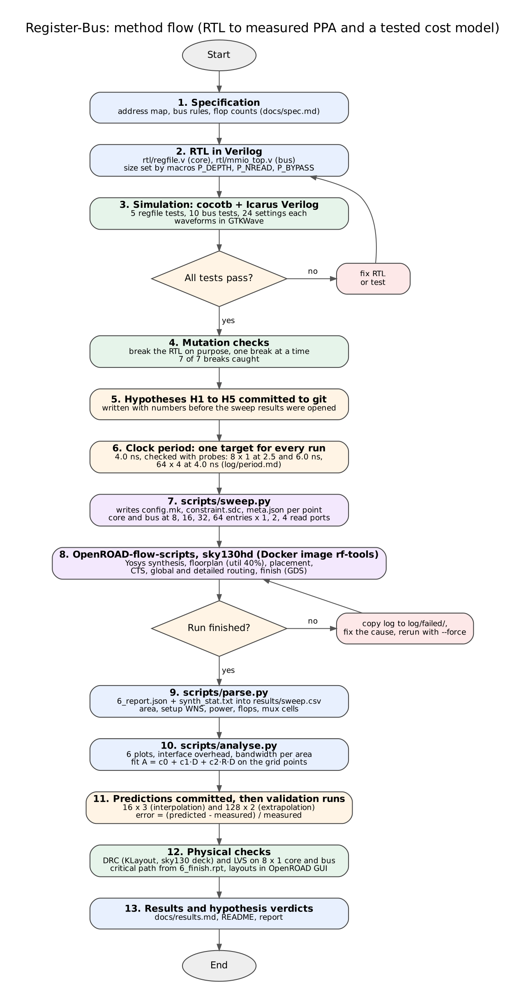

# Register-Bus

**What does a memory-mapped bus interface cost a small register file?**

A study that measures the area, timing and power of a parameterised flip-flop register file twice: once bare, and once behind a zero-wait-state bus slave. Both versions go through the same open-source RTL-to-GDSII flow (OpenROAD-flow-scripts on the SkyWater sky130hd library) with identical settings, so the difference between them is the cost of the interface.


> **Status, 5 Nov 2026.** The toolchain runs in a pinned Docker image and the example design has been taken to GDS. The register file RTL is written and its tests run. The bus wrapper is written and its tests run. For the 8 × 1 core and bus designs, DRC is clean (0 violations), LVS netlists match, and detailed routing ends with 0 violations; the layout screenshots are in `docs/layouts/`. The clock period is fixed at 4.0 ns for every run (evidence in `log/period.md`). The 18 grid points at 8 to 32 entries and the 4 held-back runs are in `results/sweep.csv`, and the 64-entry grid points are added as they finish. The block diagram, method flowchart and Yosys schematics are in `docs/figures/`, and the synthesis table is in `docs/synthesis.md`. Target for v1.0 is 14 Nov 2026.

**Quick start:** `rf make test` (setup in [Reproduce](#reproduce)).

<!-- Hero image goes here once it exists: core and bus layouts at the same size, side by side, from my own run. -->

### Results at a glance

| Question | Answer |
| --- | --- |
| Interface overhead, smallest to largest size (% of core cell area) | +32.2% at 8 × 1, 8.3% to 14.5% at 32 entries, 4.7% at the 64 × 4 probe. Absolute overhead grows from about 2,000 to 4,300 µm² (`docs/results.md`) |
| Bandwidth per area with 4 read ports versus 1 | 2.5 to 2.8 times (H5: direction supported, my guess of 1.5 to 2.5 times was too low) |
| Cost model error on the four held-back configurations | 0.5% to 5.1% (16 × 3 and 128 × 2, core and bus) |
| Worst path in the bus design | `addr[0]` to `rdata[14]` at 8 × 1 with 0.03 ns slack; `addr[0]` to `rdata` at 64 × 4 |

Every number in this table comes from `results/sweep.csv`, which is generated from the flow's own report files.

---

## Contents

1. [The question](#the-question)
2. [Design](#design)
3. [Verification](#verification)
4. [Method](#method)
5. [Hypotheses](#hypotheses)
6. [Results](#results)
7. [Limitations](#limitations)
8. [Prior work](#prior-work)
9. [How I work on this repo](#how-i-work-on-this-repo)
10. [Reproduce](#reproduce)
11. [Repository layout](#repository-layout)
12. [Progress](#progress)
13. [Author](#author)

---

## The question

How much area, timing and power does a memory-mapped bus interface add to a flip-flop register file, and how does that cost change with the number of entries and the number of read ports?

Small hardware blocks are rarely used on their own. A CPU reaches them through a bus, which brings address decode, a response mux, control and status registers, and an error path. Course projects usually measure the block and stop. Here the bare block and the block with its interface are measured under one flow setting, so the overhead comes out as a measured figure.

The study produces three things:

- **Interface overhead** in µm² and as a percentage of the bare core, at every size.
- **Peak read bandwidth per unit cell area**, to show which mix of entries and read ports moves data most cheaply.
- **An area cost model** fitted on the sweep and then tested on configurations it never saw. The prediction error is reported whatever it turns out to be.

---

## Design

Two top-level designs share one RTL source. Size is set by macros (`P_DEPTH`, `P_NREAD`, `P_BYPASS`), so one set of files covers every sweep point.

```
                 +--------------------------------------------------+
  sel, we  ----->|  mmio_top                                        |
  addr     ----->|   decode ---> err                                |
  wdata    ----->|     |                                            |
                 |     v                                            |
                 |  +-----------------+     CTRL   (RW)             |
                 |  | regfile         |     STATUS (RO)             |
                 |  |  DEPTH x 16 b   |     INPUT  (RO) <--- in_port|
                 |  |  1 write port   |                             |
                 |  |  NREAD read     |---> read mux ---> rdata     |
                 |  +-----------------+                             |
  scan_addr ---->|        ports 1..NREAD-1 ---> scan_data           |
                 +--------------------------------------------------+
```

Figures: [block diagram](docs/figures/block_diagram.png) and [method flowchart](docs/figures/method_flow.png). Yosys schematics and the cell table are described in [`docs/synthesis.md`](docs/synthesis.md).


### `rtl/regfile.v` (core-only design)

- `DEPTH` entries of 16 bits, stored in flip-flops.
- One synchronous write port and `NREAD` combinational read ports.
- Synchronous reset clears every entry.
- Optional same-cycle write-to-read bypass (`BYPASS`), held at 0 for the main sweep.

### `rtl/mmio_top.v` (with-bus design)

The register file sits behind a single-master, zero-wait-state bus slave. Read port 0 serves the bus. Read ports 1 and above become **scan ports**, read by hardware on its own, the way a display engine scans a frame buffer. A bus master can only read one address per cycle, so this is what gives `NREAD` a meaning in the bus design. With `NREAD = 1` there are no scan ports.

**Address map.** Word addresses. `AW = log2(DEPTH)`, the address is `AW + 2` bits wide, and the region is the top two bits. `DEPTH` must be a power of two and at least 4.

| Region | Offset | Name | Access | Behaviour |
| --- | --- | --- | --- | --- |
| 0 | 0 to DEPTH-1 | DATA | RW | Register file entry |
| 1 | 0 | CTRL | RW | Bit 0 `SCAN_EN`, bits 14:1 scratch, bit 15 `CLEAR` (write 1 to clear STATUS; always reads 0) |
| 1 | 1 | STATUS | RO | Bits 7:0 count of accepted DATA writes (wraps), bit 8 sticky error |
| 1 | 2 | INPUT | RO | Registered copy of the `in_port` pins |
| 1 | 3 | none | | Unmapped: raises `err`, reads 0 |
| 1 | 4 to DEPTH-1 | aliases | | Only the low two address bits are decoded in region 1, so these alias offsets 0 to 3 |
| 2, 3 | any | none | | Unmapped: raises `err`, reads 0 |

**Bus rules**

- A write lands on the rising clock edge when `sel` and `we` are both 1.
- Read data is combinational from `addr` while `sel` is 1, and 0 when `sel` is 0.
- `err` is 1 in the same cycle as any access to an unmapped address. STATUS bit 8 holds it until `CLEAR`.
- `scan_data` is 0 unless CTRL bit 0 is set.

**Design choices and the reason for each**

- *Zero wait states.* The full bus read path (address, decode, register file read mux, response mux, data out) stays inside one cycle. That path is where the interface should show up in timing, and timing is one of the things being measured.
- *Flip-flop storage.* It is what sky130hd can synthesise without an SRAM macro. RegFileStudy (see [Prior work](#prior-work)) found that a flop-based register file's instance count is "completely dominated by ports". Whether the same holds for area on sky130hd at these sizes is something this sweep will show.
- *Expected flop counts.* Core: `DEPTH × 16`. Bus: `DEPTH × 16 + 40` (15 CTRL bits, since bit 15 is never stored, plus 8 counter bits, 1 error bit and 16 INPUT bits). `parse.py` records the flop count from each run's synthesis report, and I compare it against this formula by hand. A mismatch means the size parameters did not reach Yosys.

---

## Verification

Testbenches are written in Python with [cocotb](https://www.cocotb.org/) (1.9.x, `cocotb<2`) and simulated in Icarus Verilog. Each suite has directed tests plus a random-traffic test checked against a Python reference model.

| Suite | Tests | What they cover | State |
| --- | --- | --- | --- |
| `tb/test_regfile.py` | 5 | Reset, write then read on every address, same-cycle read of the written address, no write when `we` is low, random traffic against the model | 5 of 5 passing in all settings |
| `tb/test_mmio.py` | 10 | Reset state, DATA read and write, CTRL, unmapped access and `err`, write counter and `CLEAR`, INPUT register, idle bus reads 0, scan ports, scan with bypass, random bus traffic | 10 of 10 passing on the bus design |

`make test-all` runs both designs over 4 sizes × 3 read-port counts × 2 bypass settings, which is 48 configurations.

**Mutation checks.** Each suite was run against deliberately broken RTL, one break at a time, and at least one test must fail for each break. Some breaks can only be seen in some configurations, so the table says where each one is run.

| Design | Break | Run with | Caught |
| --- | --- | --- | --- |
| regfile | write ignores `we` | any | yes (`log/mutations.md`) |
| regfile | reset does nothing | any | yes (`log/mutations.md`) |
| regfile | `BYPASS` ignored | `BYPASS=1` | yes (`log/mutations.md`) |
| mmio_top | write counter adds 2 | any | yes (`log/mutations_bus.md`) |
| mmio_top | offset 3 treated as mapped | any | yes (`log/mutations_bus.md`) |
| mmio_top | scan gate removed | `NREAD ≥ 2` | yes (`log/mutations_bus.md`) |
| mmio_top | bypass ignored | `BYPASS=1` | yes (`log/mutations_bus.md`) |

---

## Method



**Sweep**

| Parameter | Values |
| --- | --- |
| Entries (`DEPTH`) | 8, 16, 32, 64 |
| Width | 16 bits, fixed |
| Read ports (`NREAD`) | 1, 2, 4 |
| Design | core (`regfile`), bus (`mmio_top`) |
| Bypass | 0 |

That gives 24 grid runs. Four more runs are held back to test the cost model: 16 entries × 3 ports (inside the grid, so an interpolation) and 128 entries × 2 ports (outside it, so an extrapolation), each on both designs.

**Flow settings held constant for every run**

| Setting | Value |
| --- | --- |
| Platform | sky130hd, the platform's default corner (to be named from the platform config before v1.0) |
| `CORE_UTILIZATION` | 40 |
| `PLACE_DENSITY_LB_ADDON` | 0.20 |
| Clock period | 4.0 ns for every run. The probe table, the decision rule and the runs that miss it are in `log/period.md` |
| Input and output delay | 20% of the period each, so the combinational bus read path is a timed path |
| Tools | One Docker image, versions in [Reproduce](#reproduce) |

**Metrics**

| Metric | Definition | Source | Caveat |
| --- | --- | --- | --- |
| `area_um2` | Instance area at the end of the flow | `finish__design__instance__area` in `6_report.json` | Includes buffers added by clock tree synthesis and timing repair, so it depends on the target period. Tap cells are counted, fill cells are not |
| `wns_ns` | Signed worst setup slack at the end of the flow | `finish__timing__setup__ws` | Can be positive. Negative means the target period is missed |
| `period_est_ns` | Target period minus `wns_ns` | derived | For comparing designs only. See the note below |
| `power_mw` | Total power × 1000 | `finish__power__total` | Default switching activity, so use it to rank designs only |
| `bw_gbps` | `NREAD × 16 / period_est_ns` | derived | Peak, assuming every read port delivers one word per cycle |
| `bw_per_kum2` | `bw_gbps / (area_um2 / 1000)` | derived | Peak bandwidth per 1000 µm² of cells |
| `pj_per_bit` | `power_mw × target_period_ns / (NREAD × 16)` | derived | Power per unit of peak bandwidth at the target clock. Includes leakage, the clock tree and idle storage, so it is not the energy of one read |
| Interface overhead | Bus area minus core area, also as % of core | derived | Same `DEPTH` and `NREAD` on both sides |

The metric key names were checked against the flow's report on the example design (gcd) and are recorded in `log/keys.md`.

**Note on `period_est_ns`.** Read paths that go from an input pin to an output pin (`addr → rdata`, `raddr → rdata`, `scan_addr → scan_data`) only get 60% of the period once the 20% input and 20% output delays are taken off. Register-to-output and input-to-register paths get 80%. For an input-to-output path, the period at which it just meets timing is `target − wns_ns / 0.6`. That is longer than `period_est_ns` when slack is negative and shorter when slack is positive. So `period_est_ns` is a consistent comparison figure across designs, and it is not quoted as a maximum frequency.

**Cost model**

With width fixed, area is modelled separately for each design as

```math
A(D, R) = c_0 + c_1 D + c_2 R D
```

where D is the number of entries and R the number of read ports. The reasoning: storage grows with D, each read port adds a mux tree that also grows with D, and decode, I/O and control add a constant. This form is my guess. The fit decides whether it holds.

**Validation protocol**

1. Fit on the 12 grid points of each design. Report R² and the largest relative residual.
2. Refit on entries ≤ 32 only and predict 64 entries (an extrapolation). Report the error.
3. Commit predictions for the four held-back runs to `log/predictions.md`, then run them. Report interpolation and extrapolation errors separately.

I treat an error above 10% as a reason to look for a cause. That threshold is my own working choice.

---

## Hypotheses

Each hypothesis, and a numeric prediction for it, is committed to `log/hypotheses.md` before the first sweep run, so the commit history shows the prediction came first.

| # | Hypothesis | Disproved if | Verdict |
| --- | --- | --- | --- |
| H1 | Area of each design fits `A = c0 + c1·D + c2·R·D` | Largest relative residual over the 12 grid points is above 10% | Supported: largest residual 7.0%, validation error 0.5% to 5.1% |
| H2 | Bus overhead as a percentage of core area falls as entries grow, at every `NREAD`; the absolute overhead in µm² stays roughly flat | Overhead % at 64 entries is not lower than at 8 for any `NREAD` | Partly: percentage falls at every port count, absolute overhead grows from about 2,000 to 4,300 um2 |
| H3 | The bus design's critical path runs from `addr` to `rdata` through decode and the read mux | The timing report shows a different start or end point | Supported at 8 x 1 and 64 x 4 (worst path starts at `addr[0]`, ends at `rdata`) |
| H4 | Power ranks the 24 runs in nearly the same order as area | Spearman rank correlation between power and area is below 0.9 (threshold is my choice) | Supported: Spearman 0.998 |
| H5 | Adding read ports raises peak bandwidth faster than it raises area | `bw_per_kum2` falls from `NREAD = 1` to `NREAD = 4` at any `DEPTH` | Direction supported: bandwidth per area at 4 ports is 2.5 to 2.8 times the 1-port value |

---

## Results

This section is filled only from `results/sweep.csv` and `results/summary.md`. The numbers below cover the 22 rows collected so far; the 64-entry grid points are added once they are parsed.

### Interface overhead

Bus overhead is +32.2% area and +19.4% power at 8×1. The percentage falls as the register file grows (8.3% to 14.5% at 32 entries, 4.7% at the 64×4 probe) while the absolute overhead rises from about 2,000 to 4,300 µm². H2 is only partly supported. The full table of pairs is in `docs/results.md`. *Still pending:* plot 4 and the 64×1 and 64×2 pairs.

### Bandwidth per area

Bandwidth per area at 4 read ports is 2.5 to 2.8 times the 1-port value, against my guess of 1.5 to 2.5 times. H5: direction supported, size missed. *Still pending:* plot 5 and the best entries and ports combination for each design. If the best point sits on the edge of the grid, the real optimum may lie outside it, and the text will say so.

### Cost model on unseen points

The model fits the grid within 7.0%. On the four held-back configurations (16×3 and 128×2, core and bus) the error is 0.5% to 5.1%, and that includes the 128×2 points outside the fitted range. H1 is supported. *Still pending:* coefficients and R² in this section, and the error at 64 entries.

### What goes critical

At bus 8×1 the worst path runs from `addr[0]` to `rdata[14]` through the decode and read mux, with +0.03 ns slack. At bus 64×4 it starts at `addr[0]` and ends at `rdata`, with −0.24 ns slack. H3 is supported at both. *Still pending:* bus 64×1, cell types on each path and GUI screenshots of the path.

### Physical checks and layouts (8 × 1)

Core and bus at depth 8, one read port, from the OpenROAD flow:

- Detailed routing: 0 violations for core and bus.
- DRC (KLayout, sky130hd deck): 0 violations for core and bus.
- LVS (KLayout, sky130hd deck): netlists match for core and bus.
- Layout screenshots: `docs/layouts/core_8x1_layout.png` and `docs/layouts/bus_8x1_layout.png`.

The DRC and LVS checks are recorded in `docs/flow-notes.md`. Other sweep points will get the same checks as their runs finish.

### Plots

| # | File | Shows |
| --- | --- | --- |
| 1 | `results/plots/1_area_vs_entries.png` | Cell area against entries, one line per read-port count |
| 2 | `results/plots/2_period_vs_entries.png` | `period_est_ns` against entries |
| 3 | `results/plots/3_power_vs_entries.png` | Total power against entries |
| 4 | `results/plots/4_interface_overhead.png` | Bus area minus core area, per size |
| 5 | `results/plots/5_bandwidth_vs_area.png` | Peak bandwidth per unit cell area |
| 6 | `results/plots/6_cell_breakdown.png` | Post-synthesis flop, mux and other cell counts |

### Reproducibility check

*pending:* one point (`bus_d8_r2`) rerun from a fresh clone and compared with the sweep value. Any difference is reported as the noise level.

---

## Limitations

Written before the results and kept up to date as runs finish.

- **One PDK, one corner.** sky130hd only. Absolute numbers will not carry over to other processes.
- **One run per point.** Apart from the single reproducibility check, no point is repeated.
- **Flip-flop storage only.** No SRAM macro and no latch-based version.
- **Synchronous reset on every storage flop.** This adds logic per bit that a register file without reset would not have.
- **Power uses default switching activity.** No activity from simulation is annotated, so power is used to rank designs only.
- **Synthetic I/O constraints.** The 20% input and output delays are a modelling choice and not taken from a real system.
- **Mixed measurement stages.** Cell counts are post-synthesis. Area, timing and power are taken at the end of the flow.
- **Area depends on the clock target.** Timing repair adds buffers, so a different target period would give different areas.
- **`period_est_ns` is an estimate.** See the note under [Method](#method).
- **Fixed utilisation.** The die is sized from post-synthesis cell area at a fixed 40% utilisation.
- **One tool version.** The results compare designs against each other under one flow setting.
- **Physical checks so far cover 8 × 1 only.** DRC and LVS are clean for core and bus at depth 8, one read port. Other sweep points have not been checked yet, and the text will say so if any fail.
- **No signoff and no tapeout.** Nothing here has been fabricated.
- **Failed or odd runs:** a 64 × 4 run was lost once to two sweeps writing the same run folder and was rerun with `--force` (bus_d64_r4_p4 then finished in 11.1 min). Each one is listed here as it happens.

---

## Prior work

**[RegFileStudy](https://github.com/The-OpenROAD-Project/RegFileStudy)** (The OpenROAD Authors, BSD-3-Clause) studied register files through the OpenROAD flow before this project. It uses Chisel and bazel-orfs on a 32-bit × 64-row flop-based register file, sweeps read ports against write ports, and plots instance count after floorplan. Its conclusion is that the instance count "is completely dominated by ports" and that "the focus has to be on the access network". Credit for studying register files this way belongs to its authors.

**[DFFRAM](https://github.com/AUCOHL/DFFRAM)** and the OpenROAD [`ram` module](https://github.com/The-OpenROAD-Project/OpenROAD/blob/master/src/ram/README.md) generate flop- and latch-based memories, including multi-port register files, from standard cells. They are generators. This repo is a measurement study.

**Lysecky, Vahid and Givargis, [*Experiments with the Peripheral Virtual Component Interface*](https://www.cs.ucr.edu/~vahid/pubs/isss00_pvci.pdf)** measured the size and power overhead of bus wrappers around IP cores. It is the closest earlier work on the cost of an interface, measured at gate level and not through a full physical design flow.

| | RegFileStudy | DFFRAM / OpenROAD `ram` | Register-Bus (this repo) |
| --- | --- | --- | --- |
| Purpose | Read port vs write port cost | Generate memories | Cost of a bus interface on a register file |
| HDL and build | Chisel, Bazel | Generators | Plain Verilog, Make, Python |
| Platform | Not stated in its README | sky130 and others | sky130hd |
| Read ports | Synchronous (`SyncReadMem`) | Varies | Combinational |
| Measured | Instance count after floorplan | Area and density | Area, timing and power after the full flow |
| Bus interface | No | No | Yes, with its overhead measured separately |
| Model checked on unseen points | No | No | Yes |

**Tools this work depends on:** [OpenROAD](https://github.com/The-OpenROAD-Project/OpenROAD), [OpenROAD-flow-scripts](https://github.com/The-OpenROAD-Project/OpenROAD-flow-scripts), [Yosys](https://github.com/YosysHQ/yosys), [Icarus Verilog](https://github.com/steveicarus/iverilog), [cocotb](https://github.com/cocotb/cocotb), [KLayout](https://www.klayout.de/) and the [SkyWater SKY130 PDK](https://github.com/google/skywater-pdk).

---

## How I work on this repo

These rules apply to every file here.

- **Only measured numbers.** A figure appears in this README only if it can be traced to `results/sweep.csv` and from there to the report it came from. Each run's `6_report.json`, synthesis statistics and final timing report are copied into `runs/<id>/` and committed, so the trace stays inside the repo. Anything I expected but did not measure is labelled as a guess.
- **Predictions come before data.** Hypotheses and model predictions are committed to `log/` before the runs that test them.
- **Failed runs are kept.** A failed run's log goes to `log/failed/` before any fix, and the failure is listed under [Limitations](#limitations).
- **Tests have to catch real bugs.** Every suite gets mutation checks before its results are trusted.
- **One flow setting for every run.** Only the design and its parameters change between sweep points.
- **Pinned tools.** The whole toolchain runs in one Docker image, so a rerun later uses the same tool versions.
- **Prior work is credited** in [its own section](#prior-work).
- **A daily log.** Each working day has a file in `log/` with the goal, the expected result, what was measured and what broke.

---

## Reproduce

Everything runs inside one Docker image. The `rf` wrapper starts the container with the repo mounted, so tool commands get `rf` in front and git commands do not.

**Tool versions**

| Tool | Version |
| --- | --- |
| Docker image | Pinned by digest in `docker/Dockerfile` (see `log/versions.md`) |
| Yosys | 0.68 |
| OpenROAD, OpenROAD-flow-scripts commit, Icarus Verilog, cocotb, KLayout | Listed in `log/versions.md`; copied here at v1.0 |

**1. Build the image** (once, or after editing `docker/Dockerfile`)

```bash
git clone https://github.com/Arii-git/Register-Bus.git
cd Register-Bus
docker build -t rf-tools \
  --build-arg USERNAME=$(id -un) --build-arg UID=$(id -u) --build-arg GID=$(id -g) \
  docker
mkdir -p ~/bin && cp docker/rf ~/bin/rf && chmod +x ~/bin/rf
rf yosys -V
```

If `rf` is not found, open a new terminal so `~/bin` is on your `PATH`.

**2. Run the tests**

```bash
rf make test        # both designs at 8 entries, 2 read ports
rf make test-all    # 48 configurations, ends with ALL PASS
```

**3. Run the sweep and regenerate every result**

```bash
rf make sweep PERIOD=4.0                          # one run at a time (reason in log/period.md)
rf make parse                                     # writes results/sweep.csv
rf make analyse                                   # writes results/plots/ and results/summary.md
```

`make sweep` runs one flow at a time. To run two in parallel, call `rf python3 scripts/sweep.py --period <value> --jobs 2` directly, and only if the machine has at least 8 GB of free memory.

**4. Open a layout**

```bash
rf klayout ~/OpenROAD-flow-scripts/flow/results/sky130hd/rb_bus_d8_r1/base/6_final.gds
```

Developed on Windows with WSL2 Ubuntu and Docker Desktop, with the WSL memory limit set to 10 GB. Steps 2 to 4 will be checked from a fresh clone before v1.0.

---

## Repository layout

```
Register-Bus/
  rtl/        regfile.v, mmio_top.v
  tb/         Makefile, test_regfile.py, test_mmio.py
  scripts/    sweep.py, parse.py, keys.py, analyse.py
  runs/       one folder per sweep point: config.mk and copied reports (make.log stays local)
  results/    sweep.csv, summary.md, plots/
  docs/       spec, flow notes, results.md, synthesis.md, figures/ (block diagram, method flow, Yosys schematics), layouts/, screenshots
  log/        daily logs, versions.md, keys.md, hypotheses.md, predictions.md, period.md
  docker/     Dockerfile and the rf wrapper
  Makefile    test, test-all, sweep, parse, analyse
```

---

## Progress

| Stage | State |
| --- | --- |
| Toolchain in a pinned Docker image, example design (gcd) taken to GDS | Done |
| Metric key names checked on the example design | Done |
| `regfile.v` written | Done |
| `regfile` tests | Passing in all settings; 3 of 3 mutation checks caught |
| `mmio_top.v` | Done |
| `mmio_top` tests | 10 of 10 passing on the bus design; 4 of 4 mutation checks caught |
| DRC and LVS for 8 × 1 core and bus | Done (DRC 0 violations, LVS match) |
| Block diagram and method flowchart | Done (`docs/figures/`) |
| Synthesis table and Yosys schematics | Done (`docs/synthesis.md`, `docs/figures/`) |
| Layout screenshots for 8 × 1 core and bus | Done (`docs/layouts/`) |
| Clock period chosen from probes | Done: 4.0 ns for every run (`log/period.md`) |
| 24-point sweep collected into one CSV | In progress: 22 rows collected, 64-entry grid points being added |
| Cost model fitted and tested on 4 held-back runs | Done on the 18 grid points: error 0.5% to 5.1% (`results/summary.md`) |
| 6 plots from my own data | Done on the 22 rows collected so far; regenerate after the 64-entry points |
| Report (4 to 6 pages) | Not started |

**After the core work, in order:** the cost of the same-cycle bypass, a registered read output, a second platform (nangate45), one formal property with SymbiYosys, and GitHub Actions running the tests on every push.

---

## Author

**Arihant Chordia**, third-year B.Tech ECE (VLSI), SRM Institute of Science and Technology
GitHub: [@Arii-git](https://github.com/Arii-git)

Found a wrong number, or a claim the data does not support? Please open an issue with the line and your evidence.

## Licence

To be added with v1.0.
